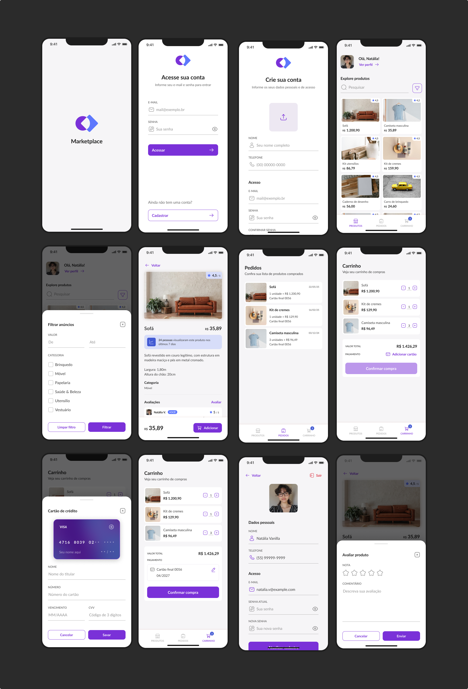

# Marketplace App 🛍️

## 📚 Informações sobre o projeto

* O projeto consiste em um aplicativo de marketplace, onde o usuário cria sua conta (com foto de perfil), faz login, explora e filtra produtos, visualiza detalhes e avaliações, favorita itens, adiciona produtos ao carrinho e finaliza compras com cartão de crédito, acompanhando depois o histórico de pedidos.
O desenvolvimento foi realizado durante a Formação React Native da [Rocketseat](https://www.rocketseat.com.br/), aplicando a arquitetura **MVVM** (View + ViewModel), consumo de API REST com autenticação JWT (com refresh token automático), cache de dados no servidor e estados globais.
&nbsp;

## 💻 Funcionalidades do projeto

* Criar conta com foto de perfil (câmera ou galeria)
* Entrar na conta (com sessão persistida e refresh token)
* Listar produtos com paginação infinita
* Pesquisar produtos por nome
* Filtrar produtos por valor (mínimo e máximo) e categoria
* Visualizar detalhes do produto e suas avaliações
* Avaliar produto (nota e comentário) e editar a própria avaliação
* Favoritar / desfavoritar produtos
* Adicionar produtos ao carrinho e alterar a quantidade
* Cadastrar cartão de crédito e selecionar forma de pagamento
* Confirmar compra
* Listar pedidos realizados
* Editar dados do perfil, foto e senha
* Notificações locais e push notifications (OneSignal)
&nbsp;

## 🔔 Notificações

O app envia dois tipos de notificação:

* **Locais**, geradas pelo próprio app:
  * 🛒 **Lembrete de carrinho**: se o usuário adiciona um produto ao carrinho e não finaliza a compra, recebe um lembrete depois de um tempo.
  * ⭐ **Avaliação da compra**: depois de finalizar um pedido, o usuário é convidado a avaliar os produtos comprados.
* **Push**, enviadas pelo servidor através do **OneSignal**, para avisos e novidades.

**Deep link:** ao tocar em uma notificação, o usuário vai direto para a tela relacionada. O lembrete abre o **carrinho** e a de avaliação abre o **produto** com a avaliação já aberta.
&nbsp;

## 🎨 Telas do projeto



&nbsp;

## 🛠️ Tecnologias/Ferramentas utilizadas

* React Native
* Expo
* Expo Router
* Typescript
* NativeWind / Tailwind CSS
* Tailwind Variants
* TanStack React Query
* Zustand
* Axios
* AsyncStorage
* React Hook Form
* Yup
* Gorhom Bottom Sheet
* Reanimated
* Expo Image Picker
* Expo Notifications
* OneSignal
* DateFns
* Toastify React Native
&nbsp;

## 🗄️ Backend

O backend (API) deste projeto está disponível em:
 [marketplace-app-push-notification](https://github.com/brenooliveiranascimento/marketplace-app-push-notification)
&nbsp;

## 🚀 Como executar o projeto

```bash
# Clone o repositório
git clone <url-do-repositorio>

# Instale as dependências
yarn

# Crie o arquivo .env a partir do exemplo e informe o App ID do OneSignal
cp .env.example .env

# Execute no Android ou iOS
yarn android
yarn ios
```

> ⚠️ Antes de executar o app, suba o [backend](https://github.com/brenooliveiranascimento/marketplace-app-push-notification) localmente na porta `3001` (`localhost` no iOS e `10.0.2.2` no emulador Android).

&nbsp;

---

<p align="center">Feito com 🧡 por <a href="https://jhonatas-portfolio.vercel.app/">Jhonatas Micael</a></p>
